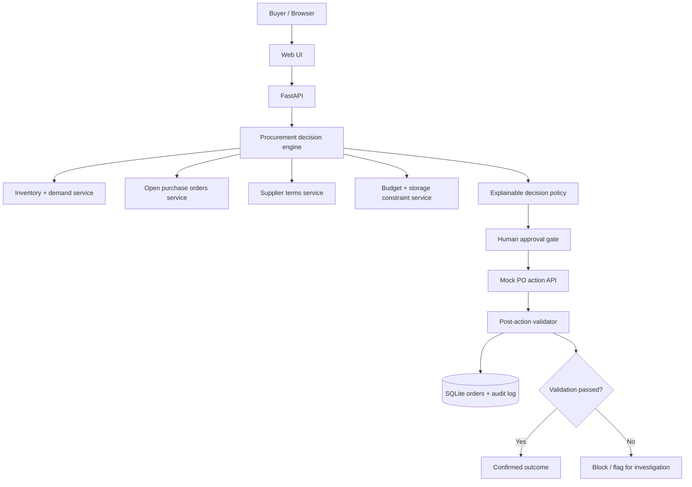

# SmartBuy AI — Procurement Decision Agent

A full-stack procurement agent prototype for the Rappi India take-home assignment. It reviews a proposed replenishment purchase, investigates inventory/demand/open POs/supplier terms/budget/storage, recommends an outcome, executes only after buyer approval, and validates the resulting purchase order.

**Scope:** Scenario 1 (Purchase Recommendation Review) implemented end-to-end, with Scenario 4 (Purchasing Constraint) represented through budget, storage, MOQ, and supplier-capacity guardrails. Scenario 2/3 are documented as extensions, not claimed as implemented.

## Why this design
The assignment is about a reliable purchasing workflow, not a chatbot. This prototype uses deterministic, explainable policy logic for critical decisions. A natural-language model is not required to prove the feedback loop and could introduce nondeterministic purchasing decisions. The interface exposes evidence, assumptions, blockers, a decision, and a validated action.

## Features
- Investigates current stock, recent demand, open purchase orders, lead time, supplier MOQ/capacity, budget, and storage capacity.
- Classifies a recommendation as `ACCEPT`, `MODIFY`, `REJECT`, or `INVESTIGATE`.
- Uses an explicit replenishment calculation: target coverage demand + safety stock − inventory − incoming open POs.
- Applies hard constraints: non-negative quantity, MOQ, supplier capacity, budget, storage capacity.
- Shows decision rationale and evidence to the buyer.
- Requires human approval before creating/modifying a mock PO.
- Re-checks conditions at execution time.
- Validates persisted PO quantity, cost, budget, storage, supplier capacity, and status.
- Feedback loop blocks invalid execution and records audit events.
- SQLite persistence and automated tests.

## Architecture


## Run locally
Python 3.10+ recommended.

```bash
python -m venv .venv
# Windows
.venv\Scripts\activate
# macOS/Linux
source .venv/bin/activate
pip install -r requirements.txt
uvicorn app.main:app --reload
```

Open http://127.0.0.1:8000. API docs: http://127.0.0.1:8000/docs

Run tests:
```bash
pytest -q
```

## Demo scenario
Default case is a recommendation to buy 800 units of `SKU-APPLE-1`.
The evidence indicates inventory, expected demand, open POs, supplier capacity, budget, and storage constraints. The agent should calculate a feasible quantity and explain whether 800 should be accepted or modified.
1. Click **Investigate recommendation**.
2. Review the decision, calculation, constraints, and evidence.
3. Click **Execute approved action** only after reviewing the proposal.
4. Observe the created PO and post-action validation checks.
5. Try **Simulate budget reduction** or **Simulate stock change** to demonstrate a changing environment and feedback guardrails. Reload to reset mock scenario data if needed.

## Decision logic and assumptions
- The decision horizon is a 7-day demand coverage window, with a configurable safety stock.
- Forecast demand is expressed as expected units for the horizon.
- `net_need = max(0, forecast_demand + safety_stock - on_hand - open_po_units)`.
- Supplier MOQ rounds a positive need upward to a valid MOQ multiple. Supplier capacity, available budget, and free storage then cap feasible quantity.
- If no feasible positive quantity exists, the agent recommends `INVESTIGATE` or `REJECT` depending on whether missing/contradictory information or a hard blocker caused it.
- An existing PO is treated as incoming supply only if it is open and for the same SKU/node.
- The mock data is deliberately small and deterministic. It is not a real retailer dataset.
- Purchase order creation is simulated; no real supplier or payment system is contacted.

## Validation and feedback loop
Before action:
1. Reload latest scenario state.
2. Verify product/node/supplier exist.
3. Recalculate inventory need.
4. Re-check MOQ, supplier capacity, budget, and storage.
5. Require explicit buyer approval.

After action:
1. Read the persisted PO back from SQLite.
2. Check quantity > 0 and supplier MOQ/capacity.
3. Check PO total <= available purchasing budget.
4. Check quantity <= available storage capacity.
5. Confirm stored SKU, node, supplier, quantity, and status match intended action.
6. If any check fails, mark the PO `VALIDATION_FAILED`, emit an audit event, and surface the mismatch rather than claiming success.

## Evaluation
Automated tests cover:
- Accept/modify decisions for proposed quantities.
- Open PO and on-hand inventory reduce net need.
- Budget/storage/supplier-capacity constraints affect feasible quantity.
- Insufficient data leads to `INVESTIGATE`.
- Purchase action requires explicit approval.
- Successful PO creation is persisted and post-validated.
- A constraint changed after recommendation blocks execution.
- Invalid SKU is rejected.

Manual evaluation rubric (0–2 each):
- Evidence completeness: inventory, demand, open PO, supplier, budget, storage.
- Decision correctness against stated constraints.
- Constraint compliance.
- Action correctness and approval gate.
- Post-action validation.
- Recovery behavior when a precondition changes.
A score of 2 means the behavior is correct and evidenced; 1 means partial; 0 means missing/incorrect.

## Scenario extensions
- **Scenario 2:** add supplier short-ship event, recompute coverage, compare alternate suppliers, and require approval before split PO creation.
- **Scenario 3:** add forecast versioning and sales anomaly detection; compare new forecast with baseline and recompute replenishment need.
- **Scenario 4:** already partially represented by budget, storage, MOQ, and supplier-capacity blockers.

## Security and repository hygiene
- No API keys or external credentials are required.
- `.env.example` contains placeholders only.
- `/api/dev/*` endpoints are demo-only and must not be exposed in production.
- Do not commit `.env`, database files, or confidential data.
